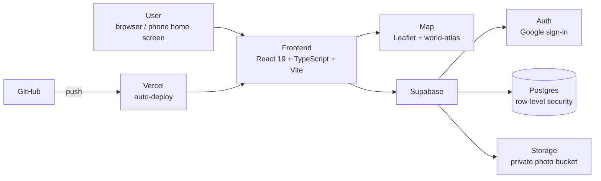
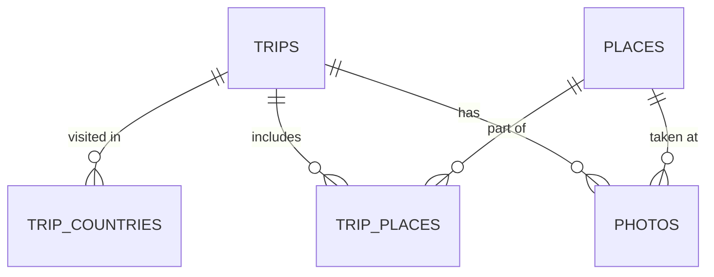

# Tripworld

A web app for logging trips on an interactive world map. Zoom from **World › Country › Trip**, save the cities and places you visited, add photos, and (in progress) log hikes with their own statistics.

**Live:** [tripworld-alpha.vercel.app](https://tripworld-alpha.vercel.app) · Login is currently limited to test users. A public demo mode is on the roadmap.

> The source code lives in a private repository. This page describes **how the software is built** and **how the project is run**.

## My role
Product owner and builder. I defined the idea, design and scope, broke the work into phases with clear "done" criteria, approved each feature before the next one started, and built it with AI-assisted development (Claude Code in VS Code).

## Architecture

| Layer | Technology | Why |
|---|---|---|
| Frontend | React 19, TypeScript, Vite, React Router | Fast development, type safety |
| Map | Leaflet, react-leaflet, world-atlas / TopoJSON | Free, lightweight map with country shapes |
| Backend | Supabase (Postgres, Auth, Storage) | Database, login and file storage without running my own server |
| Hosting | Vercel | Every push to GitHub deploys automatically |

## Data model

- **trips**: title, dates, categories (hiking, skiing, city, beach, road trip), description
- **places**: cities and places with coordinates, saved once and reused across trips
- **trip_countries / trip_places**: link tables between trips, countries and places
- **photos**: images connected to a trip and a place
- **hikes**: added later as its own feature with separate statistics

The schema is versioned as migrations (`supabase/migrations/0001_init.sql`, `0002_…`, `0003_hikes.sql`), so every change to the database is traceable.

## Security and data integrity
- **Row-level security on every table:** users can only read and change their own rows.
- **Private photo storage:** each user's files are kept in their own folder, enforced by storage policies.
- **Rules in the database, not just the UI:** end date can't be before start date, only allowed categories are accepted, and a trigger caps photos at 10 per trip.
- **No secrets in the repo:** keys live in `.env.local` and Vercel environment variables.

## How the project is run: phases
Every phase has a clear goal, and nothing moves forward until the previous step works and is approved.

| Phase | Content | Status |
|---|---|---|
| 0. Setup | Node.js, Git, VS Code, Claude Code, GitHub | ✅ |
| 1. Skeleton | Create the project, run it locally, push to a private repo | ✅ |
| 2. Database and login | Supabase project (EU region), schema, Google sign-in | ✅ |
| 3. Live | Deploy on Vercel; installable on the phone home screen | ✅ |
| 4. Features | Map and panel ✅ · Create/edit trips ✅ · Country view ✅ · Trip view ✅ · Hikes mode 🔄 · Photo upload · Stats dashboard · Mobile polish | In progress |
| Version 2 | Demo mode, GPS from photos, coloured regions, trip planning, street-level map | Backlog |

**Handling a scope change:** in November 2026 I removed cost and highest point from trips and added a separate hikes mode instead. It was handled as a database migration plus new items in the phase plan, not as ad-hoc edits.
